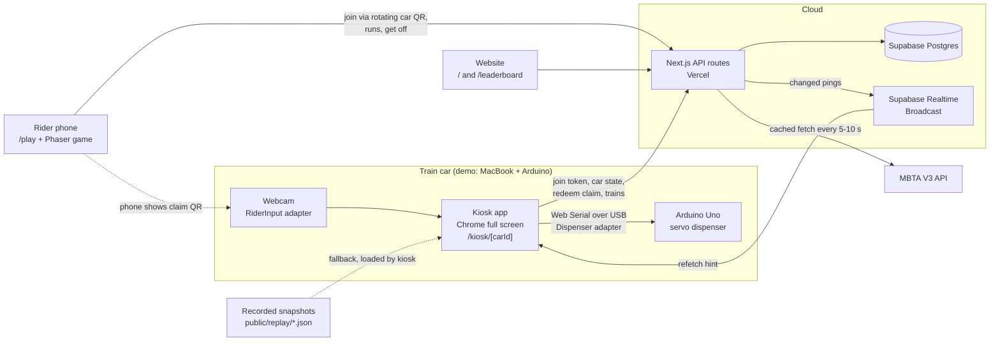
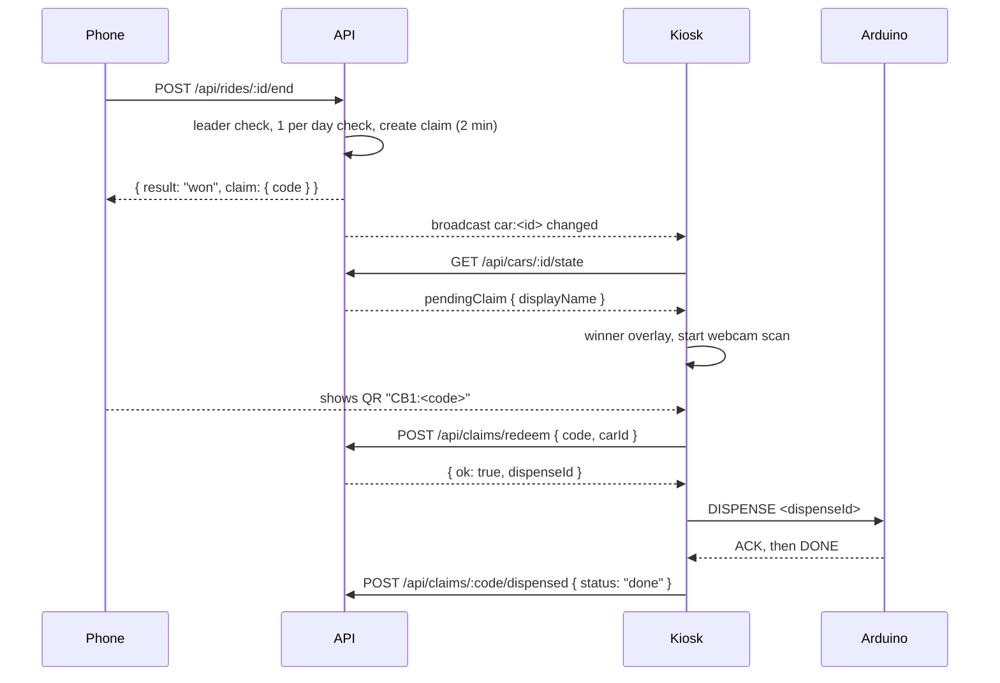

# Constant Buffers: Architecture (BostonHacks 2026)

A smart kiosk for MBTA train cars. It has a live "Spider-Tracker" map, a runner game riders play on their own phones, a per-car live leaderboard, an all-MBTA daily leaderboard, and an Arduino sticker dispenser for the car winner.

Owners: **Vivek** owns `apps/`, `packages/shared/`, `supabase/`, `scripts/`. **Jeet** owns `firmware/` and `packages/game/`.

---

## 0. Assumptions and scope

### Assumptions
- Hardware: Arduino **Uno**, one **SG90-class micro servo**, a push button, breadboard and jumpers. An IR break-beam sensor is optional. Jeet confirms the exact parts in hour 1.
- Kiosk: a MacBook running **Chrome** full screen (Web Serial is Chrome/Edge only), with its built-in webcam. One physical kiosk in the demo; the data model supports many.
- Phones: judges' own iPhones and Androids in their default browser, usually on cellular data.
- Accounts: Vercel and Supabase free tiers, plus a free MBTA V3 API key from api-v3.mbta.com.
- The two people work in parallel on `main`, in separate folders, so they rarely conflict.
- "H0" means the hour you start building. All times in §9 are relative to it.

### In scope (must ship)
- Lines: Red, Orange, Blue, Green B/C/D/E.
- Kiosk: live map, the kiosk's own train highlighted, a transfer card, the car leaderboard, a rotating join QR, a daily ticker, a winner screen, and a webcam claim scan.
- Phone: signup (display name and phone), join car, play, see your rank, "I'm getting off", claim QR.
- Website: daily leaderboard and the live map.
- Dispenser over USB serial, with mock and keyboard fallbacks.
- Replay of recorded MBTA data as a fallback.

### Cut or nice-to-have (do NOT start before H18)
- SMS OTP (Twilio Verify).
- Mattapan and Silver Line.
- 3D game, sound, skins.
- A mini map on the phone.
- A full offline `?demo=1` mode with bots (do it only if time allows; it's the best extra safety net).
- Claim refresh after expiry.
- An admin page.
- Multiple simultaneous kiosks in the demo.

### Changes to the original rider flow
1. **One-time claim QR instead of a permanent personal rider QR.** A permanent QR can be screenshotted and shared. Instead, when a leader taps "I'm getting off", the server issues a 6-character claim code that expires in 2 minutes. It is tied to that ride and car. The phone shows it as a QR (and as text), and the kiosk scans it. So the rotating car QR proves presence when you join, and the claim QR proves presence when you leave.
2. **"I'm getting off" ends the ride even for non-winners**, so riders who left don't stay on the car board.
3. **One sticker per rider per day.** Ties go to whoever set the score first.
4. **The kiosk's winner screen is driven by server state, never by the phone.** Realtime events are only a hint for the kiosk to refetch (see §7).
5. Rides auto-expire after 90 minutes.

---

## 1. Tech stack

| Layer | Pick | Why | Rejected alternative |
|---|---|---|---|
| Monorepo | pnpm workspaces, TypeScript strict | One install; the kiosk, phone, API and game share types | Turborepo: build caching doesn't matter with one app |
| Kiosk, phone, website | One Next.js app (App Router) + Tailwind | One deploy, one session story, and agents know it well | Separate Vite apps: three deploys and duplicated types |
| Backend | Next.js route handlers on Vercel | Same repo, no extra infrastructure | Express on Railway: a second deploy to look after |
| Database | Supabase Postgres via `supabase-js`, with the service key used only on the server | Real SQL views for leaderboards; free; quick to set up | Firebase: leaderboards are awkward in NoSQL |
| Realtime | Supabase Realtime **Broadcast** as a "changed" ping, plus 15 s polling as a fallback. MBTA data is polled. | Vercel functions can't hold long-lived connections, and MBTA only updates about every 10 s anyway | SSE from Vercel functions: time limits and reconnect storms |
| Validation | `zod` schemas in `packages/shared` | The same schema validates on the phone and the server | Plain TS types: no runtime checks |
| Game | Phaser 3, 2D behind-the-runner view, in `packages/game` | Input, tweens and collisions built in; runs well on phones | Three.js: a 3D camera and assets would eat the 24 h |
| QR generation | `qrcode.react` (SVG) | One component, sharp at any size | Server-rendered PNGs: an extra route and caching |
| QR scanning | `qr-scanner` (nimiq) on the kiosk webcam | Uses the native BarcodeDetector when present, with a worker fallback; small | `html5-qrcode`: bundles its own UI and is heavier |
| Rider session | Signed httpOnly cookie (`jose` JWT); phone + name signup, no OTP | About 30 minutes to build, no SMS vendor | Supabase phone auth: needs an SMS provider set up |
| Map | React SVG with a hand-made schematic JSON | Gets the Spider-Tracker look; animates with CSS transforms | Mapbox/Leaflet: geographic, so the wrong look |
| MBTA access | Server proxy `/api/trains` with a 5 s cache, plus a recorded replay file | Hides the API key; one upstream call serves every kiosk | Calling MBTA from the browser: leaks the key, hits rate limits |
| Firmware | Arduino C++ on the Uno, `Servo.h`, `arduino-cli` | Claude Code can compile and upload from the terminal | PlatformIO: more setup for the same result |
| Kiosk ↔ Arduino | Web Serial API from Chrome, 115200 baud, newline-terminated text | No extra process; hidden behind the Dispenser adapter | A Node `serialport` bridge: a second process. Firmata: more general than needed |
| Hosting | Vercel (`apps/web` as root) + Supabase cloud; the kiosk is Chrome full screen on the MacBook | Phones need a public HTTPS URL, and Web Serial needs HTTPS or localhost | Hosting on the MacBook through ngrok: flaky on venue Wi-Fi |
| Tests | Vitest for pure logic only (placement, validation, tokens) | Catches the bugs that would break the demo, cheaply | Playwright end-to-end tests: not worth it in 24 h |

---

## 2. System architecture



### 2.1 Components
- **Kiosk app** (`/kiosk/[carId]?key=…`): a Next.js page in full-screen Chrome. It renders the map, the car leaderboard, the rotating join QR and the daily ticker. It owns three adapters: `TrainFeed`, `RiderInput` and `Dispenser`. It never decides winners; it asks the API.
- **Phone app** (`/play`, `/play/run`): signup, join car, lobby (best score, rank, Play, "I'm getting off"), the full-screen game, and the claim QR.
- **Game** (`packages/game`): a framework-agnostic Phaser runner exposed through `createRunner()`. It knows nothing about the network; it reports a `RunResult`.
- **API** (`apps/web/app/api/*`): rider sessions, join tokens, rides, runs and score validation, leaderboards, claims, and the MBTA proxy. It uses the Supabase service key and sends Broadcast pings.
- **Supabase**: Postgres tables and views (§3). Row Level Security is on everywhere with no public policies, so only the server reads and writes. Broadcast channels carry "changed" pings.
- **Arduino**: dumb and reliable. It obeys the serial protocol (§5) and has its own test button.
- **Replay**: `scripts/record-mbta.ts` records real snapshots during the event. The kiosk preloads one file and loops it if live data fails.

### 2.2 Adapter interfaces (`apps/web/lib/adapters/*`)
```ts
// dispenser/types.ts
export type DispenserStatus = 'disconnected' | 'connecting' | 'ready' | 'busy' | 'error';
export interface Dispenser {
  readonly kind: 'web-serial' | 'mock' | 'http';      // 'http' = future ESP32 over Wi-Fi
  connect(): Promise<void>;                            // web-serial: must run from a click
  status(): DispenserStatus;
  onStatus(cb: (s: DispenserStatus, detail?: string) => void): () => void;
  dispense(id: string): Promise<{ ok: true } | { ok: false; error: string }>;
  disconnect(): Promise<void>;
}

// rider-input/types.ts
export interface RiderInput {
  readonly kind: 'webcam-qr' | 'keyboard' | 'nfc';      // 'nfc' = future CharlieCard/RFID tap
  start(onCode: (code: string) => void): Promise<void>;
  stop(): void;
}

// train-feed/types.ts
export interface TrainFeed {
  readonly kind: 'live' | 'replay';
  subscribe(cb: (snap: TrainSnapshot) => void): () => void;
}
```
The kiosk picks implementations from URL flags: `?dispenser=serial|mock`, `?input=webcam|keyboard`, `?feed=live|replay`. App code only imports from `adapters/*/index.ts`. Keyboard input is always active alongside the webcam, as a fallback.

### 2.3 Placing trains on the schematic
1. **Static schematic.** `scripts/build-stations.ts` calls `/route_patterns?filter[route]=<route>&include=representative_trip.stops` for each route. It writes `packages/shared/src/schematic/stations.json`: ordered parent-station ids (`place-pktrm`, …) per route and direction, with names. `layout.json` holds hand-placed `{x, y}` points per station on a 1600×1000 canvas, plus line paths. Green B/C/D/E share trunk stations.
2. **Live vehicles.** `GET /vehicles?filter[route]=Red,Orange,Blue,Green-B,Green-C,Green-D,Green-E&include=stop`. Each vehicle has `current_status` (`STOPPED_AT` / `INCOMING_AT` / `IN_TRANSIT_TO`), a `stop` (usually a platform id), `direction_id`, `label`, and `trip`. Map the platform to its parent station through the included stop's `parent_station` relationship.
3. **Position.** `target` = that parent station, and `prev` = the station before it in that route and direction's order. `progress` is 1.0 for `STOPPED_AT`, 0.85 for `INCOMING_AT`, and 0.5 for `IN_TRANSIT_TO`. The dot is drawn at `lerp(prev, target, progress)`, offset ±6 px perpendicular to the line by `direction_id`. Animate with a 1 s CSS transform transition between snapshots. All of this lives in `lib/mbta/placement.ts`, a pure function with unit tests.
4. **Output:** a `TrainSnapshot` (§4) that the kiosk and website both render.

### 2.4 How a kiosk knows which vehicle it is in
- **Demo:** the `cars` row has a `vehicle_id`. The kiosk's hidden panel (press `Shift+D`; plain `D` is a claim-code letter) lists live vehicles on the car's line, and you click one to pin it. You can also pass `?vehicle=<id>`. In replay mode, pin a vehicle from the recording.
- **Real deployment:** each kiosk is provisioned with its physical car number (for example 3812). Match it against MBTA vehicles: `label` (for example `3812-3706`) or `carriages[].label` where the API exposes it. Verify which field each line populates. Fallback: a GPS module on the kiosk's Raspberry Pi, matched to the nearest vehicle on the same route.

### 2.5 Transfer help
`GET /api/transfers?vehicleId=` does the following:
1. Fetch `/predictions?filter[trip]=<tripId>&include=stop` to get this train's upcoming stations and ETAs.
2. For upcoming transfer stations, fetch `/predictions?filter[stop]=<station>&filter[route]=<other routes>&sort=departure_time`. Transfer stations: Park St (Red/Green), Downtown Crossing (Red/Orange), State (Orange/Blue), Government Center (Green/Blue), Haymarket and North Station (Orange/Green).
3. Pick the first departure leaving at least 2 minutes after our arrival.
4. The kiosk card reads like: "On Green to Park St (4 min). Next Red Line from Park St: 3 min after you arrive." Cache for 15 s.

### 2.6 Kiosk screen (16:10 MacBook)
- **Left 62%:** the map, dark background `#05070d`, glowing MBTA line colors (Red `#DA291C`, Orange `#ED8B00`, Blue `#003DA5`, Green `#00843D`). Train dots, with this kiosk's train as a pulsing ring labeled "YOU".
- **Right 38%:** car header ("Green · Car 3812"), the transfer card, the car top 5, and the join QR with a 30 s countdown ring.
- **Bottom bar:** the all-MBTA daily ticker.
- **Overlays:** "<name> wins this car! Show your claim QR to the camera", then "Dispensing…", then "Enjoy your sticker".

### 2.7 Getting off, end to end


---

## 3. Data model (`supabase/migrations/0001_init.sql`)

```sql
create extension if not exists pgcrypto;

create table riders (
  id uuid primary key default gen_random_uuid(),
  phone text not null unique,                        -- E.164, never shown publicly
  display_name text not null check (char_length(display_name) between 2 and 16),
  created_at timestamptz not null default now()
);

create table cars (
  id text primary key,                               -- 'green-3812'
  line text not null,                                -- 'Red' | 'Orange' | 'Blue' | 'Green'
  car_number text not null,                          -- '3812'
  vehicle_id text,                                   -- pinned MBTA vehicle id (demo)
  created_at timestamptz not null default now()
);

create table rides (
  id uuid primary key default gen_random_uuid(),
  rider_id uuid not null references riders(id),
  car_id text not null references cars(id),
  started_at timestamptz not null default now(),
  ended_at timestamptz                               -- null = active
);
create index rides_active_by_car on rides(car_id) where ended_at is null;

create table runs (
  id uuid primary key default gen_random_uuid(),
  ride_id uuid not null references rides(id),
  rider_id uuid not null references riders(id),
  car_id text not null references cars(id),
  seed int not null,
  started_at timestamptz not null default now(),
  finished_at timestamptz,
  score int, coins int, duration_ms int,
  status text not null default 'started' check (status in ('started','finished','rejected')),
  reject_reason text
);
create index runs_finished_by_car on runs(car_id) where status = 'finished';

create table claims (
  id uuid primary key default gen_random_uuid(),
  code text not null unique,                         -- 6 chars, no 0/O/1/I
  ride_id uuid not null references rides(id),
  rider_id uuid not null references riders(id),
  car_id text not null references cars(id),
  score int not null,
  created_at timestamptz not null default now(),
  expires_at timestamptz not null,
  redeemed_at timestamptz,
  dispense_status text                               -- 'done' | 'error' | null
);

-- Car board: best finished run per rider, active rides only.
create view car_leaderboard as
select ru.car_id, ru.rider_id, ri.display_name,
       max(ru.score) as best_score, min(ru.finished_at) as first_at
from runs ru
join rides rd on rd.id = ru.ride_id and rd.ended_at is null
             and rd.started_at > now() - interval '90 minutes'
join riders ri on ri.id = ru.rider_id
where ru.status = 'finished'
group by ru.car_id, ru.rider_id, ri.display_name;

-- Daily board (Boston time): best finished run per rider per day.
create view daily_leaderboard as
select (ru.finished_at at time zone 'America/New_York')::date as day,
       ru.rider_id, ri.display_name,
       max(ru.score) as best_score,
       (array_agg(c.line order by ru.score desc))[1] as line
from runs ru
join riders ri on ri.id = ru.rider_id
join cars c on c.id = ru.car_id
where ru.status = 'finished'
group by 1, 2, 3;

alter table riders enable row level security;
alter table cars enable row level security;
alter table rides enable row level security;
alter table runs enable row level security;
alter table claims enable row level security;
-- No policies: only the server (service key) touches tables.

insert into cars (id, line, car_number) values ('green-3812', 'Green', '3812');
```
Sort order: `best_score desc, first_at asc`.

`0002_secure_views.sql` sets `security_invoker = true` on both views and revokes them from `anon`/`authenticated`, so the public key can't read leaderboards directly (Supabase's "Security Definer View" advisor). Only the server, with the secret key, reads them.

---

## 4. API contracts

All bodies are JSON and validated with zod schemas from `@cb/shared`. Errors use `{ error: string, code: string }` with a matching HTTP status.

- **Rider auth:** an httpOnly cookie `cb_rider` (JWT `{ riderId }`, 30 days) plus `cb_ride` (`{ rideId }`).
- **Kiosk auth:** the `x-kiosk-key` header (env `KIOSK_SECRET`), taken from `?key=` on the kiosk URL and stored in `localStorage`.

### Phone
| Method & path | Request | Response |
|---|---|---|
| `POST /api/riders` | `{ phone, displayName }` | `201 { rider: { id, displayName } }`, sets the cookie. A known phone returns the existing rider. |
| `GET /api/me` | – | `{ rider \| null, activeRide \| null }` |
| `POST /api/rides` | `{ carId, joinToken }` | `{ ride: { id, carId, line, startedAt } }`. Ends any other active ride for this rider. |
| `POST /api/runs` | `{ rideId }` | `{ runId, seed, startedAt }` |
| `POST /api/runs/:runId/finish` | `{ score, coins, durationMs }` | `{ accepted, reason?, bestThisRide, carRank, carLeaderboard: Entry[] }` |
| `POST /api/rides/:rideId/end` | – | `{ result: 'won', claim: { code, expiresAt } }` or `{ result: 'not_leader', rank, leader: { displayName, score } }` or `{ result: 'no_score' \| 'already_claimed_today' }` |
| `GET /api/claims/:code` | – | `{ status: 'pending' \| 'redeemed' \| 'expired' }` (the phone polls every 2 s) |

### Kiosk (needs `x-kiosk-key`)
| Method & path | Request | Response |
|---|---|---|
| `GET /api/cars/:carId/join-token` | – | `{ token, url, expiresAt }` (refetch every 25 s) |
| `GET /api/cars/:carId/state` | – | `{ car, leaderboard: Entry[], activeRiders, pendingClaim: { displayName, score, expiresAt } \| null }` |
| `POST /api/cars/:carId/vehicle` | `{ vehicleId }` | `{ ok: true }` (pins the demo vehicle) |
| `POST /api/claims/redeem` | `{ code, carId }` | `{ ok: true, displayName, dispenseId }` or `{ ok: false, reason: 'invalid' \| 'expired' \| 'wrong_car' \| 'used' }` |
| `POST /api/claims/:code/dispensed` | `{ status: 'done' \| 'error', detail? }` | `{ ok: true }` |

### Public
| Method & path | Response |
|---|---|
| `GET /api/trains` | `TrainSnapshot` |
| `GET /api/transfers?vehicleId=` | `{ nextStops: { stationId, name, etaMin }[], suggestions: { atStationId, atStationName, toRoute, departsInMin, ourEtaMin }[] }` |
| `GET /api/leaderboard/daily?date=YYYY-MM-DD` | `{ date, entries: { rank, displayName, score, line }[] }` |

### Shared types
```ts
export type Entry = { rank: number; displayName: string; score: number };
export type TrainVehicle = {
  id: string; route: string; directionId: 0 | 1; label: string; tripId: string | null;
  status: 'STOPPED_AT' | 'INCOMING_AT' | 'IN_TRANSIT_TO';
  stationId: string; prevStationId: string | null; progress: number; // 0..1
};
export type TrainSnapshot = { fetchedAt: string; source: 'live' | 'replay'; vehicles: TrainVehicle[] };
```

### Realtime
- **Supabase Broadcast channels:** `car:<carId>` and `mbta:daily`.
- The server sends `{ event: 'changed', payload: { kind: 'leaderboard' | 'rider_joined' | 'claim_pending' | 'claim_redeemed' | 'daily' } }`.
- **Payloads are only hints.** The kiosk always refetches `/state` (debounced 300 ms), because anyone holding the public anon key could send fake broadcasts.
- **Fallback:** the kiosk also polls `/state` every 15 s and `/api/leaderboard/daily` every 30 s.
- **MBTA data:** polling only. The kiosk calls `/api/trains` every 10 s; the server caches upstream for 5 s.
- Send broadcasts from route handlers through supabase-js's REST broadcast path (no subscribe needed). Check the current supabase-js docs for the exact call.

### Join token and claim code
- **Join token:** `base64url(carId + '.' + window) + '.' + hmac16`, where `window = floor(now / 30 s)`. The server accepts the current or previous window, so a token lives at most 60 s. The QR URL is `https://<app>/play?car=<carId>&t=<token>`.
- **Claim code:** 6 characters from `ABCDEFGHJKLMNPQRSTUVWXYZ23456789`. The QR content is `CB1:<code>`; the kiosk ignores anything without the `CB1:` prefix. Codes expire after 120 s. `dispenseId` is the first 8 hex characters of the claim id.

---

## 5. Kiosk ↔ Arduino serial protocol v1

**Link:** 115200 baud, 8N1, ASCII lines ending in `\n` (ignore `\r`), at most 32 characters per line. The constants live in `packages/shared/src/serial-protocol.ts`, and the firmware mirrors them.

| Host → Arduino | Arduino → Host | Meaning |
|---|---|---|
| (port opens; the Uno resets) | `READY cb-dispenser v1` | Sent once at boot. The host waits up to 3 s for it before sending anything. |
| `PING` | `PONG` | Heartbeat, every 5 s while idle |
| `DISPENSE <id>` | `ACK <id>` then `DONE <id>` | Drop one sticker. `<id>` is 1–12 characters `[A-Za-z0-9]`. |
| `DISPENSE <id>` while busy | `ERR <id> BUSY` | |
| `DISPENSE <id>` with the same id as last success | `DONE <id>` | Idempotent retry; no second drop |
| (sensor fitted, no drop seen in 1.5 s) | `ERR <id> NODROP` | Optional IR break-beam |
| `STATUS` | `STATUS idle count=<n>` (or `busy`) | |
| `SERVO <deg>` | `OK SERVO <deg>` | Debug only: calibrate angles |
| (button on D2 pressed) | `BTN` then `DONE btn` | Local test dispense, works without the host |
| anything else | `ERR - BADCMD` | |

### Sketch behavior (`firmware/dispenser/dispenser.ino`)
- **Pins:** servo signal on D9, button on D2 (`INPUT_PULLUP`), status LED on D13, optional IR break-beam on D3.
- **Boot:** attach the servo, move to `REST_DEG`, detach, print `READY`.
- **Non-blocking state machine with `millis()`** (no long `delay()`), so `PING` and `STATUS` still answer during a dispense.
  - IDLE → (DISPENSE) → PUSHING (attach, go to `PUSH_DEG`, about 400 ms) → HOLD (200 ms) → RETURN (`REST_DEG`, about 400 ms) → detach → `DONE`.
  - Detaching while idle stops servo buzz.
- **LED:** solid when idle, slow blink while dispensing, fast blink for 3 s after an error.
- **Power:** the servo runs from a separate 5 V supply with a shared ground, or at least has a 470 µF capacitor across its power pins. Otherwise brownouts reset the Uno mid-demo.
- **Mechanism (Jeet's call):** a gravity-fed vertical sticker magazine with a servo-driven slider pushing out the bottom sticker. A cardboard or 3D-printed tube works.

### Host behavior (`lib/adapters/dispenser/web-serial.ts`)
- **Connect:** `navigator.serial.requestPort()` on a button click the first time; after that, `getPorts()` auto-reconnects.
- **Handshake:** wait for `READY`. Mark the dispenser disconnected after 2 missed `PONG`s.
- **Dispense:** `dispense(id)` resolves on `DONE <id>`, or fails on `ERR` or a 4 s timeout. It retries once with the same id; that's safe because the firmware is idempotent.

---

## 6. Repo layout

```
constant-buffers/
├── CLAUDE.md
├── README.md
├── package.json                 # root scripts: dev, build, typecheck, lint, test
├── pnpm-workspace.yaml          # apps/*, packages/*
├── tsconfig.base.json
├── .env.example
├── docs/
│   ├── ARCHITECTURE.md
│   └── DEMO.md                  # demo script + fallback checklist (written at H19)
├── apps/
│   └── web/                     # @cb/web: kiosk + phone + website + API
│       ├── app/
│       │   ├── page.tsx                     # website: live map + daily leaderboard
│       │   ├── leaderboard/page.tsx
│       │   ├── kiosk/[carId]/page.tsx
│       │   ├── play/page.tsx                # QR landing: signup → join → lobby
│       │   ├── play/run/page.tsx            # full-screen game
│       │   ├── dev/dispenser/page.tsx       # Web Serial test panel
│       │   ├── dev/game/page.tsx            # game harness, needs no env vars
│       │   └── api/…                        # routes from §4
│       ├── components/{kiosk,play,map,ui}/
│       ├── lib/
│       │   ├── adapters/{dispenser,rider-input,train-feed}/
│       │   ├── mbta/{client,snapshot,placement,transfers}.ts
│       │   ├── db.ts            # server-only Supabase client
│       │   ├── realtime.ts      # broadcast send (server) / subscribe (client)
│       │   ├── session.ts       # rider cookies (jose)
│       │   ├── tokens.ts        # join tokens, claim codes
│       │   └── rate-limit.ts
│       └── public/replay/       # recorded MBTA snapshots
├── packages/
│   ├── shared/                  # @cb/shared: types, zod, serial protocol, game rules, schematic
│   │   └── src/{index,api,serial-protocol,game-rules,lines}.ts, schematic/{stations,layout}.json
│   └── game/                    # @cb/game: Phaser runner (Jeet)
│       └── src/{index.ts,config.ts,scenes/}
├── firmware/                    # Jeet
│   ├── dispenser/dispenser.ino
│   └── README.md                # parts, wiring, angles, upload commands
├── supabase/migrations/0001_init.sql
└── scripts/
    ├── record-mbta.ts           # snapshot every 10 s → public/replay/<date>.json
    ├── build-stations.ts        # MBTA → schematic/stations.json
    └── seed-demo.ts             # fake riders with beatable scores
```
Packages ship TypeScript source (`"exports": "./src/index.ts"`) and Next transpiles them (`transpilePackages: ['@cb/shared', '@cb/game']`). Phaser loads client-only (`next/dynamic` with `ssr: false`).

### Game contract (`@cb/game`)
```ts
export interface RunResult { score: number; coins: number; durationMs: number; distance: number }
export interface RunnerOptions {
  seed: number;
  theme?: { lineColor: string };
  onScoreChange?: (score: number) => void;
  onGameOver: (result: RunResult) => void;
}
export function createRunner(parent: HTMLElement, opts: RunnerOptions): { destroy(): void; restart(seed: number): void };
```
Game rules live in `@cb/shared/game-rules.ts`, and both the game and the server use them:
```ts
export const GAME = { LANES: 3, START_SPEED: 12, MAX_SPEED: 30, SCORE_PER_METER: 1, COIN_VALUE: 10, MAX_COINS_PER_SEC: 4 } as const;
export const MAX_SCORE_PER_SEC = GAME.MAX_SPEED * GAME.SCORE_PER_METER + GAME.MAX_COINS_PER_SEC * GAME.COIN_VALUE; // 70
```
- **Controls:** swipe left/right to change lanes, swipe up to jump, swipe down to duck. Arrow keys also work.
- Set `touch-action: none` on the canvas, and lock scrolling while playing.

---

## 7. Security and anti-cheat (hackathon-sized)

- **Presence:** you can only join with a join token from the last 60 s, so a photo from home goes stale. You can only claim a prize by showing a 2-minute, one-time code to the kiosk camera.
- **Score validation** on `finish`. A run is rejected (stored with a `reject_reason`) unless all of these hold:
  - the run is in `started` status and belongs to this rider and an active ride;
  - `durationMs ≥ 3000`;
  - `durationMs ≤ (now − run.started_at) + 2000`;
  - `score ≤ durationMs / 1000 × MAX_SCORE_PER_SEC × 1.1 + 50`;
  - `coins × COIN_VALUE ≤ score`;
  - the run is younger than 10 minutes.
  - Each run can be finished only once.
- **Rate limits** (in-memory per instance plus database counts; good enough here):
  - signup: 5 per minute per IP;
  - join: 10 per minute per rider;
  - start run: 1 per 3 s per rider;
  - redeem: 10 per minute per kiosk.
- **Prizes:** one redeemed claim per rider per day. Requires at least `PRIZE_MIN_RIDERS` active riders in the car (1 for the demo).
- **Secrets:** the Supabase service key, `SESSION_SECRET` and `MBTA_API_KEY` are server-only. The kiosk key appears in the URL; that's acceptable for a demo.
- **Realtime:** Broadcast is untrusted; events only trigger refetches.
- **Privacy:** phone numbers are never returned by any endpoint. Display names are trimmed to 16 characters.
- **Known demo-grade gap:** anyone who knows a phone number can sign in as that rider. OTP is the nice-to-have fix.

---

## 8. Demo plan (2 minutes)

| Time | Judges see |
|---|---|
| 0:00–0:20 | The kiosk in full screen: real trains moving on the Spider-Tracker map, "YOU" on our Green car, and the transfer card ("Next Red at Park St: 3 min"). |
| 0:20–0:40 | A judge scans the rotating QR with their own phone, enters a name and phone number, and joins Car 3812. The kiosk shows "<name> boarded". |
| 0:40–1:15 | The judge plays the runner. Vivek plays on a second phone. The car board updates live on the kiosk. Seeded riders have beatable scores. |
| 1:15–1:40 | The judge taps "I'm getting off". The kiosk shows "<name> wins this car!". The judge holds the claim QR to the webcam, and the Arduino drops a sticker. |
| 1:40–2:00 | The daily ticker and website. Then the pitch: adapters swap the webcam for a CharlieCard tap, the MacBook for a car-mounted Pi screen, and USB for an ESP32 over Wi-Fi. |

### Fallbacks
Drill each one at least once before judging. The kiosk's hidden panel (press `Shift+D`; plain `D` is a claim-code letter) shows the feed, dispenser and realtime status and lets you toggle each.

| If this fails | Do this |
|---|---|
| Venue Wi-Fi | Put the MacBook on a phone hotspot. The judges' phones use cellular. |
| MBTA API, or no trains (service pauses roughly 1–5 AM) | The kiosk switches to replay after 3 failed fetches. Force it with `?feed=replay`. Record replay data in the evening while trains run. |
| Webcam scan | Type the 6-character code on the MacBook keyboard. It's always listening. |
| Arduino or serial | `?dispenser=mock` shows an animation, the Arduino's button dispenses locally, or hand over the sticker. |
| Supabase Realtime | Nothing to do; 15 s polling keeps the board updating. |
| Everything online | The `?demo=1` local mode if it was built; otherwise the backup video. |
| Everything | A 2-minute screen recording of a clean run, made at H21. |

---

## 9. Roadmap (H0 = start of build)

**Contracts to agree in hour 1** (15 minutes, both people, then frozen):
1. Serial protocol v1 (§5)
2. The `Dispenser` interface (§2.2)
3. The `createRunner` / `RunResult` contract and the `GAME` constants (§6)
4. The car id format `<line>-<number>`
5. Folder ownership (§ top)

| Hour | Vivek (software) | Jeet (hardware → game) |
|---|---|---|
| H0–1 | Agree contracts. Run the kickoff prompt → scaffold pushed to `main`. | Agree contracts. Take parts inventory, install `arduino-cli`, blink an LED, test a servo sweep. |
| H1–2 | Supabase project + migration, env vars, first Vercel deploy of the scaffold. | Clone the repo, run his prompt. Firmware: protocol v1. |
| H2–4 | Rider signup, join tokens, rides/runs API, phone lobby. | Build the mechanism (magazine + slider). Calibrate angles with `SERVO <deg>`. |
| H4–5 | Kiosk shell: layout, rotating QR, `/state` + Broadcast subscription. | Firmware finished and tested in `arduino-cli monitor`. |
| **H5** | **IP1: dispenser through `/dev/dispenser` over Web Serial** | **IP1** |
| H5–6 | Start `scripts/record-mbta.ts` in the background (keep it running 60+ min). Build `/api/trains`. | 20 dispenses in a row, power fix, mount it. |
| H6–9 | `build-stations`, the layout JSON, the map renderer, placement + tests. | Game: lanes, swipe, jump/duck, obstacles. |
| H9–11 | "YOU" highlight, transfer card. | Game: coins, speed ramp, game over, MBTA theme. |
| H11–12 | `/play/run` with the stub runner → submit flow. | **IP2 (H12): real game merged, mounts through `createRunner`** |
| H12–15 | Sleep | Game polish on a real iPhone and Android over LAN |
| H15–18 | Get off → claim → webcam scan → redeem → dispense (mock dispenser) | Sleep |
| **H18** | **IP3: full flow end to end with real hardware** | **IP3** |
| H18–19 | Daily leaderboard page + kiosk ticker, `seed-demo`, fallback flags, hidden `Shift+D` panel. | Physical kiosk setup: stand, "Car 3812" sign, sticker stock. |
| H19–20 | Anti-cheat checks, rate limits, write `docs/DEMO.md`. | Bug bash on phones |
| **H20** | **Feature freeze** | |
| H20–22 | Rehearse 5 times; drill every fallback; record the backup video at H21. | Same |
| H22–23 | Devpost, README, screenshots | Hardware photos, wiring diagram for Devpost |
| H23–24 | Buffer | Buffer |

Until IP2, Vivek integrates against the stub runner in `packages/game`. Until IP1, he uses the mock dispenser. Jeet's work never waits on the backend: `/dev/game` and `/dev/dispenser` run with no env vars.

---

## 10. Risks and open questions (most likely to break the demo first)

1. **The webcam can't read a phone-screen QR** (glare, low brightness, autofocus). *Mitigation:* show a huge QR and tell riders to turn brightness up; the typed code is always active; test at the venue lighting.
2. **Web Serial quirks:** the Uno resets when the port opens, the port is busy if the Arduino IDE serial monitor is open, and the first connection needs a click. *Mitigation:* wait for `READY`, close other serial tools, add a "Connect dispenser" button, keep the mock fallback.
3. **Mechanism jams or a servo brownout.** *Mitigation:* separate servo power, the 20-in-a-row test, the physical button, spare stickers by hand.
4. **Venue Wi-Fi.** *Mitigation:* the hotspot; deploy early so Vercel is warm.
5. **iOS Safari game quirks** (page scrolls on swipe, viewport jumps, low frame rate). *Mitigation:* `touch-action: none`, test on a real iPhone by H12, cap the render resolution.
6. **MBTA data:** a missing API key means 20 requests/min; there's no service overnight; branch ordering can be odd. *Mitigation:* get the key in H1, record replay data early, unit-test placement.
7. **The schematic layout becomes a time sink.** *Mitigation:* 4 lines, rough hand-placed coordinates, timebox to 2 hours.
8. **Realtime drops.** *Mitigation:* polling (already designed in).
9. **Scope creep.** *Mitigation:* the cut list in §0; nothing new after H20.

### Open questions
- Jeet's exact parts: servo model, whether there's an IR sensor, an external 5 V supply, and what to build the magazine from.
- Sticker size and stock: this decides the magazine dimensions.
- The judging format: a table demo or rotating judges? Do they hold their phones up to us?
- Devpost tracks or sponsor prizes worth aiming for, such as hardware, mobile, or social good.
- Should seeded fake riders appear on the daily board during judging? It's honest to say they are seeded.
